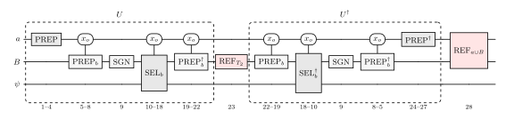
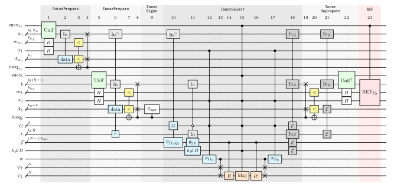

# dfthcbe

This is an implementation of the DFTHC block encoding of a SOSSA Hamiltonian, and its corresponding qubitized walk operator, referenced in "Fast quantum simulation of electronic structure by spectral amplification", Phys. Rev. X **15**, 041016 (2025) [[1]](#references).

Every bloq in this implementation is decomposable into elementary gates except the three measurement-based erasures, namely `RotDataErase` and the two alias erases, which for now (see issue [#14](https://github.com/Covestro-HPQC/dfthcbe/issues/14)) are accounted for by their cost in the call graph. The resource count, numeric or symbolic, can be produced for generic input parameters. The walk operator and its sub-bloqs can be simulated by tensor contraction with `exact_erase=True`, which replaces each erasure by the exact inverse of its read.

## Sum-of-squares form of the Hamiltonian and spectral amplification

With its two-body tensor DFTHC-factorized, the electronic-structure Hamiltonian $H$ on $N$ spatial orbitals can, up to a constant $E_{\mathrm{SoS}}$, be written as a sum of squares of $2N + RC$ generators:

```math
H_{\mathrm{SA}} = H - E_{\mathrm{SoS}}
  = \sum_{G \in \lbrace D_1, Q_1 \rbrace} \sum_{r, \sigma} O^\dagger_{G\sigma,r} O_{G\sigma,r}
  + \sum_{r \in [R],\, c \in [C]} O^\dagger_{\mathrm{SF},rc} O_{\mathrm{SF},rc}
  = \sum_{\alpha \in [2N + RC]} O^\dagger_\alpha O_\alpha \succeq 0 .
```

Both kinds of generator are written in the Majoranas rotated onto a unit vector, $\tilde\gamma_{u \sigma f} = \sum_p u_p \gamma_{p \sigma f}$, of flavour $f \in \lbrace 0, 1 \rbrace$. The $RC$ two-body (SF) generators come from the DFTHC factors: $R$ ranks of $C$ copies, each a $B$-term sum over unit vectors $u^{(r)}_b$ with real weights $w^{(r,c)}_b$, plus an identity weight $w^{(r,c)}_B$ as the extra term $b = B$,

```math
O_{\mathrm{SF},rc} = \frac{1}{\sqrt{2}} \Big( w^{(r,c)}_B + \frac{i}{2} \sum_{b \in [B],\, \sigma}
  w^{(r,c)}_b \, \tilde\gamma_{u^{(r)}_b \sigma 0} \tilde\gamma_{u^{(r)}_b \sigma 1} \Big) .
```

The $2N$ one-body generators come from the eigenvectors $u^{(r)}$, $r \in [N]$, of the effective one-body matrix $h^{(1)\prime}$: an annihilator ($D_1$) for each positive eigenvalue $w_+^{(r)}$, a creator ($Q_1$) for each negative one $-w_-^{(r)}$, on either spin,

```math
O_{D_1\sigma,r} = \sqrt{w^{(r)}_+} \, a_{u^{(r)} \sigma},
\qquad
O_{Q_1\sigma,r} = \sqrt{w^{(r)}_-} \, a^\dagger_{u^{(r)} \sigma},
\qquad
a_{u \sigma} = \tfrac{1}{2} \big( \tilde\gamma_{u \sigma 0} + i \tilde\gamma_{u \sigma 1} \big) .
```

The constant is

```math
E_{\mathrm{SoS}} = - \lVert h^{(1)\prime} \rVert_1 + \mathrm{Tr}\big[ h^{(1)} \big]
  + \frac{1}{2} \sum_{pq} h^{(2)\prime}_{ppqq}
  - \frac{1}{2} \sum_{r \in [R],\, c \in [C]} \big( w^{(r,c)}_B \big)^2 ,
```

with $h^{(1)}$ the one-body integrals, $h^{(2)\prime}$ the DFTHC two-body tensor, and $\lVert \cdot \rVert_1$ the sum of the absolute eigenvalues.

The circuit block-encodes $H_{\mathrm{SA}}$ through its square root. PREP weights each generator by its LCU one-norm $\lambda_\alpha \geq \lVert O_\alpha \rVert$,

```math
\lambda_{D_1\sigma,r} = \sqrt{w^{(r)}_+},
\qquad
\lambda_{Q_1\sigma,r} = \sqrt{w^{(r)}_-},
\qquad
\lambda_{\mathrm{SF},rc} = \frac{1}{\sqrt{2}} \sum_{b \in [B+1]} \big\lvert w^{(r,c)}_b \big\rvert ,
```

and SEL applies a block encoding of each generator,

```math
\mathrm{PREP} \lvert 0 \rangle = \frac{1}{\lambda_{\mathrm{sqrt}}} \sum_{\alpha} \lambda_\alpha
  \lvert \alpha \rangle \lvert \mathrm{garb}_\alpha \rangle,
\qquad
\mathrm{SEL} = \sum_\alpha \lvert \alpha \rangle \langle \alpha \rvert \otimes
  \mathrm{BE}[O_\alpha / \lambda_\alpha],
\qquad
U = \mathrm{SEL} \cdot \mathrm{PREP},
```

with $\lambda_{\mathrm{sqrt}}^2 = \sum_\alpha \lambda_\alpha^2$. A reflection $\mathrm{REF}_ {T_2}$ on the inner ancillas $B$ of each $\mathrm{BE}[O_\alpha / \lambda_\alpha]$ squares the generators, and a reflection $\mathrm{REF}_{a \cup B}$ on all ancillas makes the result a qubitization walk:

```math
\mathrm{BE}\Big[ \frac{H_{\mathrm{SA}}}{\Lambda} - I \Big] = U^\dagger \, \mathrm{REF}_{T_2} \, U,
\qquad
W = \mathrm{REF}_{a \cup B} \, U^\dagger \, \mathrm{REF}_{T_2} \, U,
```

with normalization

```math
\Lambda = \tfrac{1}{2} \lambda_{\mathrm{sqrt}}^2
  = \lVert h^{(1)\prime} \rVert_1
  + \frac{1}{4} \sum_{r \in [R],\, c \in [C]} \Big( \sum_{b \in [B+1]} \big\lvert w^{(r,c)}_b \big\rvert \Big)^2 .
```

The block encoding is the bloq `DFTHCBlockEncoding`, and $W$ the bloq `DFTHCWalk`. $W$ has eigenphases $\arccos(E_j / \Lambda - 1)$ for the eigenvalues $E_j$ of $H_{\mathrm{SA}}$, the lowest of which is the gap $E_{\mathrm{gap}} = E_{\mathrm{gs}} - E_{\mathrm{SoS}}$. Resolving energies near the gap to $\delta E$ then takes about $\lambda_{\mathrm{eff}} / \delta E$ walk steps, with $\lambda_{\mathrm{eff}} = \sqrt{E_{\mathrm{gap}} (2 \Lambda - E_{\mathrm{gap}})}.$

## The walk operator: bloq by bloq

### The walk operator



$|x_o\rangle$ is the outer selection, with $X_o = N + RC$ values, together with the spin $\sigma_1$ of a D1/Q1 generator. Each $\mathrm{BE}[O_\alpha / \lambda_\alpha]$ is an inner LCU over $b$, so all three inner boxes read $x_o$:

```math
\mathrm{SEL} = \sum_{x_o} \lvert x_o \rangle \langle x_o \rvert \otimes
  \mathrm{PREP}_{b, x_o}^\dagger \, \mathrm{SEL}_{b, x_o} \, \mathrm{PREP}_{b, x_o} .
```

In the figure $a$ aggregates the set of outer selection registers ($x_o$, $m_{x_o}$, $\sigma_1$) whereas $B$ combines the inner ones ($b$, $m_b$, $\sigma_0$), and $\psi$ the $2N$ system qubits. Steps 5-22 (in the figure) run twice, the second time inverted, so the inverted half uses `InnerSelect.adjoint()` (the Majorana gate is not Hermitian).

| steps | bloq | what it does |
|---|---|---|
| 1-4 | `OuterPrepare` | alias sampling over $x_o$, the generator index; $\sigma_1$ to the plus state |
| 5-8 | `InnerPrepare` | alias sampling over $b$ on each SF row |
| 9 | `InnerSigns` | the signs of $w^{(r,c)}_b$ |
| 10-18 | `InnerSelect` | load the Givens angles, rotate, apply `Maj`, rotate back, erase |
| 19-22 | `InnerPrepare.adjoint()` | undo 5-8 |
| 23 | `DFTHCBlockEncoding.ref_t2` | $\mathrm{REF} _{T_2}$: reflect on $B$ where $\mathrm{succ} _{x_o} = 1$, $-I$ where $\mathrm{Unif}(x_o)$ failed |
| 24-27 | `OuterPrepare.adjoint()` | undo 1-4 |
| 28 | `DFTHCWalk.ref_ab` | $\mathrm{REF}_{a \cup B}$: reflect on $a$ and $B$ together |

Steps 1-27 correspond to the `DFTHCBlockEncoding`, and `DFTHCWalk` is obtained by appending step 28. Both can be controlled with exactly one extra Toffoli: the block encoding controls only $\mathrm{REF} _{T_2}$, since on $\mathrm{ctrl} = 0$ the rest is $U^\dagger U = I$, and the walk also controls $\mathrm{REF} _{a \cup B}$, whose control is free.

### The block encoding, step by step



Steps 1-23, with the register widths in symbols. The bands carry the bloq names, and the step numbers are the `(n)` in the code's comments and docstrings. Each unprepare undoes its prepare one operation per step, in reverse: steps 19-21 undo the swap, undo the inequality test and erase the alias data of 6-8, as steps 24-26 do for 2-4. Steps 24-28 appear in the walk figure.

| mark | meaning |
|---|---|
| `Unif` | equal superposition over the register's range, success flagged on $\mathrm{succ}$ |
| `In` | QROM address; `In^<` and `In^>=` address only `x_o < RC` and `x_o >= RC` |
| cyan box | QROM output |
| `<` | inequality test ($\mathrm{keep}$ against the uniform register $m$) |
| `E` | erase by X-measurement |
| `In_Z` | the phase fixup of that erase, addressed like the read |
| `R`, `Maj` | Givens ladder and Majorana gate on the system |

## Installation

Needs Python 3.10 or newer. From the repository root:

```bash
pip install .        # or pip install -e . to edit the code in place
```

This pulls in [Qualtran](https://github.com/quantumlib/Qualtran) 0.7 or newer (tested with 0.7.0 and `main`). The notebooks' call-graph drawings also need Graphviz's `dot`.

## From DFTHC decomposition tensors

We have bundled six example DFTHC fits under `data/dfthc/*/factors.npz`, each with the arrays `U`, `W`, `w_B`, and the D1/Q1 split of $h^{(1)\prime}$, `w_plus`, `u_plus`, `w_minus`, `u_minus`. The walk is built from them directly:

```python
import numpy as np
from dfthcbe import DFTHCWalk

factors = np.load('data/dfthc/naphthalene/factors.npz')
keys = ('U', 'W', 'w_B', 'w_plus', 'u_plus', 'w_minus', 'u_minus')
walk = DFTHCWalk.from_factors(**{k: factors[k] for k in keys}, b_rot=15, b_k1=15, b_k2=15)
be = walk.block_encoding
be.Lambda             # 4.054: <0|BE|0> = H_SA / Lambda - I
be.encoded_factors()  # the fit as the walk encodes it
```

`encoded_factors()` is the fit as the walk encodes it, with its tables rounded to the walk's bits, not the input fit. It also holds the failures of the two $\mathrm{Unif}$, whose rotations are rounded to $s_u$ bits (`s`), so that each fails with a small probability. A failed $\mathrm{Unif}(b)$ turns `Maj` off on an SF row, but step 9 still gives the branch a sign, which adds to $w_B$ (`InnerPrepare.failure_signs`, issue [#42](https://github.com/Covestro-HPQC/dfthcbe/issues/42)). A failed $\mathrm{Unif}(x_o)$ is $-I$ under $\mathrm{REF} _{T_2}$, which only raises $\Lambda$ to $\Lambda / (1 - P(\mathrm{succ} _{x_o} = 0))$. So the walk's operator is exactly that of `encoded_factors()`. `encoded_factors(exact_prep=True)` leaves the failures out.

Furthermore `b_k1`, `b_k2` are the bits $b_{k_1}$, $b_{k_2}$ of the two alias $\mathrm{keep}$ values; either can be given as a precision instead, `precision_outer` or `precision_inner`, which sets the bits by Qualtran's `sub_bit_prec_from_epsilon`. The QROAM block sizes `k_1`, `k_2` and those of their erasures default to the cheapest in Toffolis. A walk operator can also be assembled from its three sub-bloqs, `DFTHCWalk(DFTHCBlockEncoding(outer, inner, select))` (see `notebooks/dfthc_walk.ipynb` for an example), or built in symbols with `DFTHCWalk.symbolic(...)` for closed forms of the cost. Neither holds a `Lambda` factor.

Effective integrals `(h1e, eri)` can be reconstructed for both the DFTHC Hamiltonian and the block-encoded one:

- `walk_integrals(**factors)`, with the constant `walk_e_sos(W, w_B, w_minus)` (Eq. 30 of [[1]](#references)): what the walk operator encodes, $H_{\mathrm{SA}} + E_{\mathrm{SoS}}$ with $H_{\mathrm{SA}} = \sum_\alpha O^\dagger_\alpha O_\alpha$, in the DFTHC BLISS frame. On `be.encoded_factors()` it gives the effective Hamiltonian the walk operator encodes, so its FCI energy shows what the bits of precision cost.
- `reconstruct(U, W, h_sym, h1)`: the physical Hamiltonian, with the BLISS shift undone.

`hamiltonian_matrix(h1e, eri)` writes the Hamiltonian as a matrix on the `2**(2*N)` Fock states of the walk's system registers `(psi_up, psi_dn)`, to compare with a simulation of the circuit.

## Notebooks

Two notebooks in `notebooks/` cover the package from two sides.

The first one, [`notebooks/using_dfthcbe.ipynb`](notebooks/using_dfthcbe.ipynb), is intended to show practical usage of the package. It builds the walk of Fe4S4 from its DFTHC decomposition tensors, with the alias tables given in bits or as a target precision. It counts the Toffolis and qubits of the walk, controlled and not, and of the walk operator of every example in `data/dfthc`, draws the call graph with the Toffolis and qubits of each part, at any size, for instance to see how the walk operator grows with the bits of its angles. It shows how one can simulate parts of the walk operator as well: the two alias reads classically, with Qualtran's `call_classically`, address by address, and the equal superposition by tensor contraction. Last, for H2 in STO-3G, it contracts the whole block encoding, checks that `<0|BE|0> = H_SA / Lambda - I` for the Hamiltonian that the circuit encodes, and computes its ground-state energy. It then follows the error of the ground-state energy as the bits grow, or as the precision of the alias tables tightens.

[`notebooks/dfthc_walk.ipynb`](notebooks/dfthc_walk.ipynb) is a more in-depth explanation of how the walk is built. It builds the walk three times: a tiny test case, the real-system Fe4S4 fit and `DFTHCWalk.symbolic` for the closed forms. It goes through the walk box by box, in circuit order. The sections are supplied by quantikz figures, drawn as the code builds it. The symbolic counts are verified to be equal to the numerics, and `Maj` and the Givens ladder are also simulated, to show that they apply the operators they should. It ends with the comparison with Low *et al.* [[1]](#references), row by row, in closed form and at FeMoco-54 (the FeMoco instance of their Table III, $N = 54$ and $`(R, B, C) = (10, 27, 27)`$), where the walk is 9641 Toffolis against their 9997.

## Tests

```bash
python -m pytest tests                  # default, about two minutes
python -m pytest tests -m intensive     # exhaustive sweeps and cirq cross-checks, about 15 minutes
```

Every bloq is checked twice: **correctness** through simulation by tensor contraction at a few orbitals (or `call_classically` for the permutations), up to the block `<0|W|0>` of the whole walk at `N = 2`, which, built from H2 in STO-3G, is checked against the Hamiltonian of the fit it encodes, its integrals read back off the block; and **cost** from the call graph, at FeMoco-54 and against the symbolic closed form. The error of the encoded fit is bounded by that of the input fit rounded to the same bits. The `intensive` tier, deselected by default and run in CI after every merge into `main`, builds the block from two random fits more, sweeps every `InnerSelect` branch at `N = 2` and `N = 3`, and checks both PREPAREs once more in cirq. The fits in `data/dfthc` are checked against FCI with pyscf, skipped if it is not installed.

## Costs

[`notebooks/dfthc_walk.ipynb`](notebooks/dfthc_walk.ipynb) derives these counts part by part.

### Comparison with [[1]](#references)

Each row is the symbolic call-graph count of its part of `DFTHCWalk.symbolic(N, R, B, C, b_rot, b_k1, b_k2, k_1, k_2, k_e1, k_e2, s)`, which, with the sizes substituted, equals the count of the concrete circuit. The paper's column is the equation of [[1]](#references) for each row of their Table III, in the symbols below. Their $b_2$ (B36) also counts a sign bit, so B37 and B50 read $b_2 + 1$ here, and B50's $N$, the phase fixup of the D1/Q1 angles, sits at step 18, where `dfthcbe` applies it. Each pair of steps is a forward pass and its adjoint.

| steps | operation | `dfthcbe` | Low *et al.* | $\Delta$ |
|---|---|---|---|---|
| | *`OuterPrepare`, once per walk* | | | |
| 1, 27 | $\mathrm{Unif}(x_o)$, twice | $2[n_x > 0]\,(4n_x + 2s_u - 5)$ | $8 \lg X_o$ (B24, B54) | $2[n_x > 0]\,(2s_u - 5) - 8\eta_x$ |
| 2-4 | read, test, swap | $M_1 + K_1 b_1 - 2$ | $M_1 + K_1 b_1$ (B29) | $-2$ |
| 24-26 | undo swap and test, erase | $b_1 + \lceil X_o / K_{e1} \rceil + K_{e1} - 4$ | $b_1 + \lceil X_o / K_5 \rceil + K_5$ (B53) | $-4$ |
| | *`InnerPrepare`, twice per walk* | | | |
| 5, 22 | $\mathrm{Unif}(b)$, twice | $2[n_b > 0]\,(4n_b + 2s_u - 5)$ | $8 \lg(B+1)$ (B32, B52) | $2[n_b > 0]\,(2s_u - 5) - 8\eta_b$ |
| 6-8 | read, test, swap | $M_2 + \beta_N s(\hat B) - 2 + (K_2 - 1)(b_2 + 2) + b_2$ | $M_2 + (K_2 - 1)(b_2 + 1) + b_2 + 1$ (B35, B37) | $(K_2 - 1) + \beta_N s(\hat B) - 3$ |
| 9 | signs, `InnerSigns` | $0$ | $0$ (B19) | $0$ |
| 19-21 | undo swap and test, erase | $b_2 + \lceil RC / K_{e2} \rceil + \beta(\lceil RC / K_{e2} \rceil, \lceil X_o / K_{e2} \rceil) + K_{e2} (B+1) - 4$ | $b_2 + 1 + \lceil RC(B+1) / K_4 \rceil + K_4$ (B50) | $\beta(\lceil RC / K_{e2} \rceil, \lceil X_o / K_{e2} \rceil) - 5$ |
| | *`InnerSelect`, twice per walk* | | | |
| 10 | D1/Q1 angles | $N + s(RC) - 2$ | $N$ (B41) | $s(RC) - 2$ |
| 11 | SF angles | $RB + s(R) - 1$ | $RB$ (Tab. III) | $s(R) - 1$ |
| 12, 17 | `sg` multiplexer | $4$ | $0$ (no row) | $+4$ |
| 13, 17 | `USwap`, twice | $2N$ | $2N$ (Tab. III) | $0$ |
| 14, 16 | Givens ladders, `GivensRotationLadder` and its adjoint | $4(N - 1)(b_{\mathrm{rot}} - 1)$ | $4 b_{\mathrm{rot}} (N - 1)$ (Tab. III) | $-4(N - 1)$ |
| 15 | `Maj` | $5$ | $7$ (Fig. 4) | $-2$ |
| 18 | erase, $(b, r)$ fixup | $R + B - 3$ | $R + B$ (B47) | $-3$ |
| 18 | erase, $x_o$ fixup | $N + s(RC) - 2$ | $N$ (B50) | $s(RC) - 2$ |
| | *reflections, once each per walk* | | | |
| 23 | `REF_T2` | $b_2$ | $b_2 + 1$ (B11) | $-1$ |
| 28 | `REF_aB` | $b_1 + b_2 + 1$ | $b_1 + b_2 + 2$ (B55) | $-1$ |

Each term of $\Delta$ has one of six causes:

1. **Constants.** A QROM walk over $\ell$ leaves with $k$ controls costs $\ell + k - 2$ Toffolis, a one-hot over $K$ values $K - 2$, a phase-gradient addition of $b_{\mathrm{rot}}$ bits $b_{\mathrm{rot}} - 1$, and a $Z$ with $n$ controls $n - 1$. These give all of $\Delta$ at steps 2-4, 14, 16, 23, 24-26, 28 and the $(b, r)$ fixup of 18, and the constant terms at 10, 11 (whose walk has one control, $G_0 = 0$), the $x_o$ fixup of 18, the $-2$ at 6-8 and the $-4$ at 19-21. The erases are compared at $K_{e1} = K_5$ and $K_{e2}(B+1) = K_4$. At 23, B11 also reflects the rotated qubit of the paper's $\mathrm{Unif}(b)$, which ours does not have. At 28, B55 reflects both rotated qubits but not $\sigma_1, \sigma_0$, the same count, and adds 1 for the unary iteration on the phase-estimation control, which belongs to phase estimation, not to $W$.
2. **Zero rows.** The walks also step past rows that are all zero. The dead addresses are still values of the register, so the walk must stop on them, one stop per aligned block of the dead interval ($s(D)$ for a prefix $[0, D)$, $\beta(a, b)$ in general), and in a nested walk each stop still carries a pruned sub-walk over the second address: $+s(RC)$ at 10 and at the $x_o$ fixup of 18 for the $RC$ SF prefix, $+\beta_N s(\hat B)$ at 6-8 and $+\beta(\lceil RC / K_{e2} \rceil, \lceil X_o / K_{e2} \rceil)$ at 19-21 for the $N$ D1/Q1 tail rows, and $+s(R)$ at 11 for the identity row $b = B$ (a one-row dead interval, $\beta(B, B+1) = 1$). The stops are needed, prefix and suffix alike: a walk that skipped them would alias live rows onto the dead branches. The paper skips the identity row, and shares one walk over $x_o$ between steps 6 and 10 and between 21 and 18, the only way to remove them (issue [#13](https://github.com/Covestro-HPQC/dfthcbe/issues/13)). On top of the needed stops, Qualtran splits dead nodes that straddle the end of the iteration range where a stop would do (issue [#22](https://github.com/Covestro-HPQC/dfthcbe/issues/22)): at FeMoco-54 that is one Toffoli per call at step 11 (the $s(R) - 1$ beyond the one needed stop) and nothing at steps 6 and 21.
3. **Sign bits.** An inner entry carries two sign bits, `sgn` and `d_sgn`, where B36's $b_2$ counts one. So the swaps of step 6 move one bit more, $+(K_2 - 1)$ (to be addressed in issue [#34](https://github.com/Covestro-HPQC/dfthcbe/issues/34)). The test and the swap of steps 7-8, and their undo at 19-20, touch neither and cost $b_2$, where B37 and B50 charge $b_2 + 1$: $-1$ at 6-8 and at 19-21.
4. **Uniform superpositions.** Steps 1, 27: the paper's $4 \lg X_o$ is the $4 \lg X_o + 2 s_u - 13$ of [[2]](#references), which amplifies all $\lg X_o = \eta_x + n_x$ qubits of $x_o$, at $s_u = 7$ and without the $+1$. Ours amplifies only the $n_x$ high qubits, the $\eta_x$ low ones getting a Hadamard, for $4 n_x + 2 s_u - 5$: $3 n_x$ for three comparisons, $n_x - 1$ for a `MultiAnd`, and $s_u - 2$ for each of the two rotations, where [[2]](#references) has $n_x - 2$ and $s_u - 3$. Steps 5, 22 are the same for $b$, with $\lg(B+1) = \eta_b + n_b$.
5. **`sg`.** Steps 12, 17: computing $\sigma_{G_0}$ into `sg`, the control of the spin swap, and uncomputing it costs 4. Table III has no row for it, though App. B 2 sec. 3 computes `sg` for 2 and erases it by measurement (to be addressed in issue [#14](https://github.com/Covestro-HPQC/dfthcbe/issues/14)).
6. **`Maj`.** Step 15: Fig. 4 controls each of its four gates on the AND of the two success flags, $2 + 4 + 1 = 7$. Ours combines the flags with $G_0$ in two ANDs, $\mathrm{succ} _{x_o} \wedge G_0$ for D1/Q1 and $\mathrm{succ} _{x_o} \wedge \neg G_0 \wedge \mathrm{succ} _b$ for SF, so only one gate needs a control more: $2 + 1 + 2 = 5$. That also leaves D1/Q1, which does not use $b$, on where $\mathrm{Unif}(b)$ failed.

At FeMoco-54 the walk costs 9641 Toffolis, 356 fewer than the 9997 of [[1]](#references). Their Table III evaluates B37 and B50 at $b_2 = 20$, so their column above gives $9997 + 34$.

The symbols and registers, their names in the code (blank: written out), and their values at FeMoco-54:

| symbol | meaning | in the code | FeMoco-54 |
|---|---|---|---|
| $N$ | spatial orbitals, the qubits of each of `psi_up`, `psi_dn` | `num_orb` | 54 |
| $R$, $C$ | DFTHC rank, and copies per rank | `num_r`, `num_c` | 10, 27 |
| $B$ | terms per rank; $b$ takes $B + 1$ values, $b = B$ the identity | `num_b` | 27 |
| $X_o = N + RC$ | values of the generator index $x_o$, the $RC$ SF ones first | `num_x` | 324 |
| $b_{\mathrm{rot}}$ | bits per Givens angle, and of the phase-gradient register | `b_rot` | 15 |
| $b_{k_1}$, $b_{k_2}$ | bits of the alias $\mathrm{keep}$ values, outer and inner | `b_k1`, `b_k2` | 15, 15 |
| $s_u$ | bits of the two rotations of each $\mathrm{Unif}$ | `s` | 7 |
| $k_1$, $k_2$ | $\log_2$ block sizes of the alias reads, steps 2 and 6, the cheapest by default | `k_1`, `k_2` (`log_block_size`) | 2, 4 |
| $k_{e1}$, $k_{e2}$ | the bits of $x_o$ in the one-hot of their erases, steps 26 and 21; step 21's also holds all of $b$; the cheapest by default | `k_e1`, `k_e2` (`erase_log_block_size`) | 4, 2 |
| $K_1$, $K_2$ | the read block sizes, $2^{k_1}$ and $2^{k_2}$ | | 4, 16 |
| $K_{e1}$, $K_{e2}$ | $2^{k_{e1}}$ and $2^{k_{e2}}$, the values of $x_o$ in each erase's one-hot | | 16, 4 |
| $K_5$, $K_4$ | the paper's, $2^{k_5}$ (B53) and $2^{k_4}(B+1)$ (B50) | | 16, 112 |
| $\lg y$ | $\lceil \log_2 y \rceil$, the bits of a register with $y$ values | prints `ceiling(log2(y))` | $\lg X_o = 9$ |
| $\eta_x$, $\eta_b$ | the powers of two in $X_o$ and $B + 1$: $X_o = 2^{\eta_x} l_x$, $B + 1 = 2^{\eta_b} l_b$, with $l_x$, $l_b$ odd | `v2` | 2, 2 |
| $n_x$, $n_b$ | $\lg l_x$, $\lg l_b$: the top qubits of $x_o$, $b$ that a $\mathrm{Unif}$ amplifies | | 7, 3 |
| $[n_x > 0]$, $[n_b > 0]$ | 1 if the $\mathrm{Unif}$ amplifies, 0 if its range is a power of two | prints `Min(1, ...)` | 1, 1 |
| $b_1$, $b_2$ | alias widths $\lg X_o + b_{k_1}$, $\lg(B+1) + b_{k_2}$: $\mathrm{alt}$ and $\mathrm{keep}$ | | 24, 20 |
| $M_1$ | $\lceil X_o / K_1 \rceil$, the leaves of the outer read's address walk | | 81 |
| $\hat B$ | $\lceil (B+1) / K_2 \rceil$, the blocks of $b$ | | 2 |
| $M_2$ | $RC \hat B$, the live leaves of the inner read's address walk | | 540 |
| $s(D)$ | the number of ones of $D$ in binary | `popcount`, prints `s(D)` | $s(RC) = s(270) = 4$, $s(R) = s(10) = 2$, $s(\hat B) = s(2) = 1$ |
| $\beta(a, b)$ | the aligned blocks $[j 2^h, (j+1) 2^h)$ that $[a, b)$ splits into | `aligned_blocks`, prints `beta` | |
| $\beta_N$ | $\beta(RC, X_o)$, the blocks of the $N$ dead rows of the inner read | | 4 |
| $\Delta$ | `dfthcbe` minus Low *et al.*, per call | | |
| *registers* | | | |
| $x_o$ | the generator index, $\lg X_o$ qubits | `x_o` | |
| $b$, $r$ | the inner index, $\lg(B+1)$ qubits; the rank of the SF row, $r = \lfloor x_o / C \rfloor$, $\lg R$ qubits | `b`, `r` | |
| $G_0$, $G_1$ | the generator family: `00` SF, `10` D1, `11` Q1 | `G0`, `G1` | |
| $\vec\theta$ | the $N - 1$ Givens angles of the branch, $(N - 1) b_{\mathrm{rot}}$ qubits | `angles` | |
| $[b \neq B]$ | 1 on an SF row with $b < B$ | `b_neq_B` | |
| $\mathrm{succ}_{x_o}$, $\mathrm{succ}_b$ | success flags of the two uniform preparations | `succ_x_o`, `succ_b` | |
| $\sigma_0$ | inner spin: SF's spin sum, and the Majorana flavour on D1/Q1 | `sigma_0` | |
| $\sigma_1$ | outer spin: the spin label of a D1/Q1 generator | `sigma_1` | |
| $\sigma$ | $\sigma_{G_0}$, the control of the spin swap | `sg` | |

## Reference

### Conventions

- **SF first.** `x_o < RC` is SF, with `x_o = rC + c`; the last `N` values are the one-body tail, its `N_+` D1 rows first, then Q1.
- **`G0 = 0` is SF.** The tail load writes `G`, the SF load fires on `G0 = 0`.
- **Signs.** `InnerPrepare` loads `sgn = [w_b < 0]` and `d_sgn = sgn XOR sgn[alt]`, and `InnerSigns` applies `Z(sgn)` and `CZ(less_than_b, d_sgn)`, so every branch carries the sign of the surviving `b`.
- **Jordan-Wigner.** `gamma_{j,0} = Z_0 .. Z_{j-1} X_j` and `gamma_{j,1} = Z_0 .. Z_{j-1} Y_j` on one spin register, qubit 0 the most significant, as in Eq. (B12) of [[1]](#references). So `a_j = Z_0 .. Z_{j-1} (X_j + iY_j)/2`: `|1>` is occupied, and on one mode `n = (1 - Z)/2`.
- **Givens ladder.** `GivensRotationLadder` applies `U(u)` with `U(u)^dag gamma_0 U(u) = sum_j u_j gamma_j`, so `Maj` only ever acts on qubit 0 of `psi_dn`: `-Z` for SF, `a_u` for D1, `a_u^dag` for Q1. An angle `theta` is stored as the integer `round(theta / (2 pi) * 2^(b_rot - 1))`.
- **`Maj`.** On qubit 0 the string is empty, so `gamma_0 = X`, `gamma_1 = Y`, and the SF pair is `i gamma_0 gamma_1 = -Z` (with `n_u = (1 + i gamma_0 gamma_1)/2`), D1's `a_u` is `(X + iY)/2`. Fig. 4 of [[1]](#references) applies `+Z` on SF, which is `i gamma_1 gamma_0`, the order of its Eq. (B1); that would flip every `w_b` against the identity term `w_B`. `Maj` applies `-Z = diag(-1, 1)` as the same `CCZ`, with the target as an open control and `b_neq_B` as the Z target, so the Toffoli count is unchanged. The Jordan-Wigner ordering does not enter: in `gamma_0 gamma_1` of one mode the string squares to the identity.
- **Erases.** By default the loaded tables are erased by X-measurement, a cost-only bloq with the phase-fixup count of [[1]](#references). `exact_erase=True` undoes each read by its exact inverse instead, a second read, which keeps every bloq unitary so it can be contracted. It warns, as that is not the circuit whose cost is reported.

## The figures

`docs/*.tex` are standalone quantikz sources sharing `docs/circuit-macros.tex`. To redraw one:

```bash
cd docs
latexmk -pdf -outdir=/tmp/ltxbuild dfthc-walk.tex
pdftocairo -svg /tmp/ltxbuild/dfthc-walk.pdf dfthc-walk.svg
```

## References

[1] G. H. Low, R. King, D. W. Berry, Q. Han, A. E. DePrince III, A. F. White, R. Babbush, R. D. Somma, and N. C. Rubin, "Fast quantum simulation of electronic structure by spectral amplification", Phys. Rev. X **15**, 041016 (2025), [doi:10.1103/pb2g-j9cw](https://doi.org/10.1103/pb2g-j9cw).

[2] Y. R. Sanders, D. W. Berry, P. C. S. Costa, L. W. Tessler, N. Wiebe, C. Gidney, H. Neven, and R. Babbush, "Compilation of Fault-Tolerant Quantum Heuristics for Combinatorial Optimization", PRX Quantum **1**, 020312 (2020), [doi:10.1103/PRXQuantum.1.020312](https://doi.org/10.1103/PRXQuantum.1.020312).

## Authors

Emiel Koridon (Covestro) and Oumarou Oumarou (Covestro) did the main work: the design and implementation of the bloqs, the tests and the documentation. Nicholas C. Rubin (Google) and Christian Gogolin (Covestro) supervised the project.

## Acknowledgements

Covestro acknowledges funding from the German Bundesministerium für Forschung, Technologie und Raumfahrt (BMFTR) through project PASQUOPS (13N17250).
